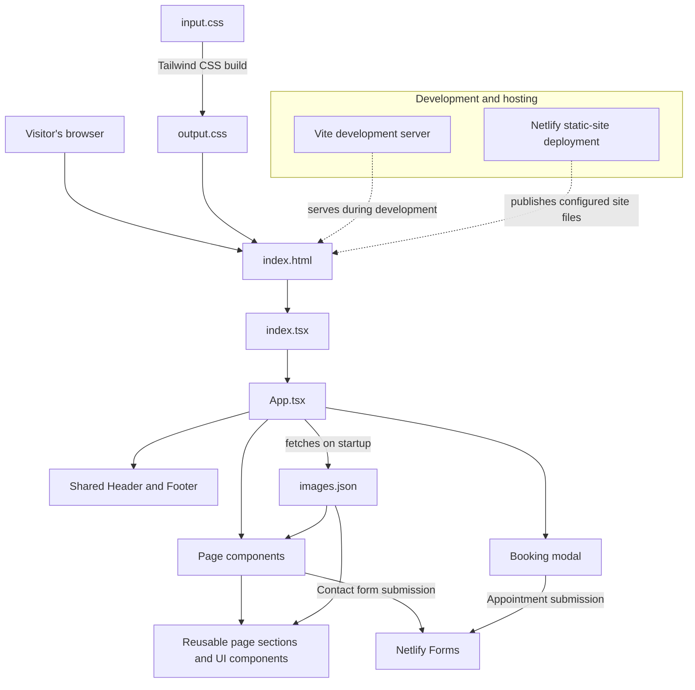

<div align="center">

# KABIRA’S Motor Vehicle Engineering & Mechanics

**A responsive business website for an automotive repair and vehicle engineering workshop in Kenya.**

[Services](#services) · [Getting Started](#getting-started) · [Architecture](#architecture) · [Deployment](#deployment)

</div>

---

## Overview

This repository contains the source for the KABIRA’S workshop website. It presents the business, its automotive services, bodywork capabilities, articles, and contact information, and lets visitors submit contact and appointment requests.

The site is a client-rendered React application. Page content is composed from reusable components, while page and component imagery is configured in `images.json`. Contact and booking forms are configured for Netlify Forms. There is no application API or database in this repository.

## Features

- Home, About, Services, Bodywork, Blog, and Contact pages
- Reusable React components for navigation, page sections, modals, and shared layout
- Service appointment and contact request forms
- Image configuration loaded from `images.json`
- Responsive styling with Tailwind CSS
- Netlify deployment configuration and form handling

## Technology Stack

| Area | Technology |
| --- | --- |
| UI | React 19, TypeScript |
| Development server | Vite |
| Styling | Tailwind CSS, PostCSS, Autoprefixer |
| Hosting and forms | Netlify configuration and Netlify Forms |

## Getting Started

### Prerequisites

- Node.js (an active LTS release is recommended)
- npm

### Install and run locally

```bash
npm install
npm run dev
```

Vite serves the development site at <http://localhost:3000>.

### Build styles

The Tailwind CSS input is `input.css`; the generated stylesheet is `output.css` and is linked by `index.html`.

```bash
# Generate CSS for development
npm run build

# Generate minified CSS
npm run build:prod

# Rebuild CSS automatically when source styles change
npm run watch
```

> `npm run build` generates the stylesheet; it is not a Vite production-bundle command.

## Project Structure

```text
.
├── App.tsx                 # Application state, page selection, and shared layout
├── index.tsx               # React application entry point
├── index.html              # HTML shell and Netlify form declarations
├── components/             # Pages and reusable UI components
├── images.json             # Image URLs grouped by page and component
├── input.css               # Tailwind CSS input
├── output.css              # Generated stylesheet used by the site
├── package.json            # Scripts and development dependencies
├── tailwind.config.js      # Tailwind configuration
├── vite.config.ts           # Vite development configuration
└── netlify.toml             # Netlify build, publish, and redirect settings
```

## Architecture



### Request and rendering flow

1. `index.html` loads the React entry point, which mounts `App.tsx`.
2. The app loads image configuration from `images.json` and renders the selected page using components in `components/`.
3. Tailwind processes `input.css` into the `output.css` stylesheet used by the site.
4. Contact and booking form submissions are posted to Netlify Forms when the site is deployed on Netlify.

## Deployment

The repository includes `netlify.toml`. Its current configuration runs `npm run build:prod`, publishes the repository root (`.`), and redirects requests to `index.html` for the client-rendered site.

To deploy with Netlify:

1. Import the repository into Netlify.
2. Use the build command and publish directory defined in `netlify.toml` (`npm run build:prod` and `.`).
3. Confirm that Netlify detects the `contact-page` and `booking-modal` forms after deployment, then submit a test request for each form.

## Configuration and Content

- Update page and component image URLs in `images.json`. The site fetches this file at runtime, so the deployed file must remain available at the site root.
- Update business copy and page content in the relevant files under `components/`.
- Update the Tailwind theme and content paths in `tailwind.config.js` as needed.

## Suggested Repository Name

**`kabiras-auto-workshop`** is a clearer, more professional name than `gigs-offer` and matches the actual project and business. Other options include `kabiras-motors-website` and `kabiras-automotive`.

> Renaming the repository is optional and separate from this README update. If you rename it, update any external deployment settings or links that refer to the current repository URL.

## License

No license file is currently included. Add a `LICENSE` file before presenting this project as open source or granting reuse rights.
