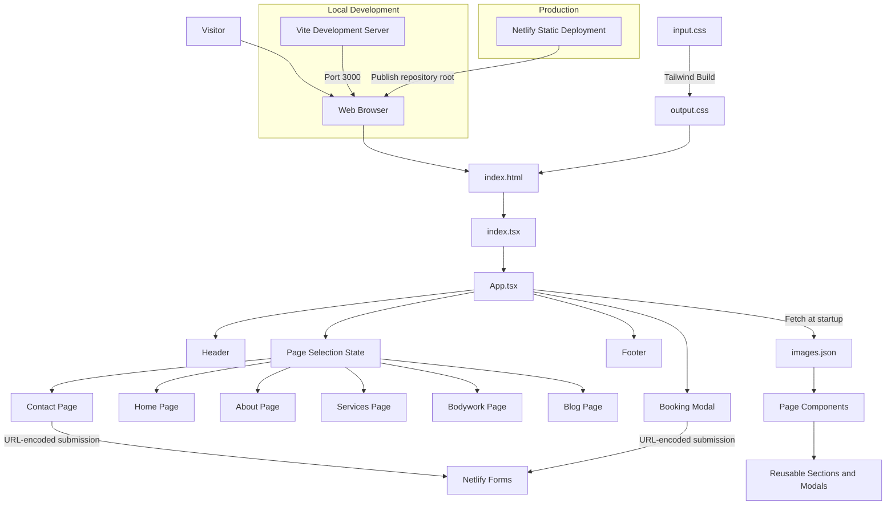

# KABIRA'S Motor Vehicle Engineering & Mechanics


A responsive, client-side business website for **KABIRA'S Motor Vehicle Engineering & Mechanics**, an automotive service workshop serving Karatina and Eldoret, Kenya.

The platform presents workshop services, bodywork capabilities, company information, automotive articles, contact details, and service booking options.

## Table of Contents

- [Overview](#overview)
- [Key Features](#key-features)
- [Technology Stack](#technology-stack)
- [Architecture](#architecture)
- [Project Structure](#project-structure)
- [Getting Started](#getting-started)
- [Available Scripts](#available-scripts)
- [Content and Configuration](#content-and-configuration)
- [Netlify Deployment](#netlify-deployment)
- [Known Project Considerations](#known-project-considerations)
- [Recommended Repository Name](#recommended-repository-name)
- [License](#license)

## Overview

KABIRA'S provides a focused digital experience for customers seeking vehicle repair and engineering services. Visitors can explore available services, learn about workshop processes, read automotive articles, and submit contact or appointment requests.

The application is a lightweight React single-page application without a dedicated backend. Business content is maintained through React components and `images.json`, while form submissions are handled by Netlify Forms.

## Key Features

- Responsive navigation for desktop and mobile devices
- Dedicated Home, About, Services, Bodywork, Blog, and Contact views
- Service details presented through reusable cards and modals
- Booking modal with vehicle, service, date, and contact fields
- Contact form with Netlify Forms submission handling
- Runtime image configuration through `images.json`
- Responsive layout and branded typography using Tailwind CSS
- FAQ, testimonial, process, and call-to-action sections
- Google Maps integration on the contact page
- Netlify redirects for client-side application routes

## Technology Stack

| Area | Technology |
| --- | --- |
| UI library | React 19 |
| Language | TypeScript 5.9 |
| Build and development server | Vite 7 |
| Styling | Tailwind CSS 3.4, PostCSS, Autoprefixer |
| Forms | Netlify Forms |
| Hosting | Netlify |
| Maps | Google Maps Embed |

## Architecture



### Rendering Flow

1. `index.html` provides the application shell and hidden Netlify form definitions.
2. `index.tsx` mounts the React application into the `#root` element.
3. `App.tsx` manages the selected page, navigation state, loading state, image configuration, and booking modal.
4. Page components receive data from `images.json` and render reusable UI sections.
5. Tailwind CSS processes `input.css` into `output.css`, which is loaded by `index.html`.
6. Contact and booking submissions are posted to Netlify Forms in production.

## Project Structure

```text
.
├── App.tsx                 # Application state and page composition
├── index.tsx               # React application entry point
├── index.html              # HTML shell and Netlify form definitions
├── components/
│   ├── Header.tsx          # Navigation and mobile menu
│   ├── Footer.tsx          # Shared footer
│   ├── HomePage.tsx        # Home page composition
│   ├── AboutPage.tsx       # About page
│   ├── ServicesPage.tsx    # Services listing
│   ├── BodyworkPage.tsx    # Bodywork and refinishing page
│   ├── BlogPage.tsx        # Blog and article interface
│   ├── ContactPage.tsx     # Contact information and booking form
│   └── BookingModal.tsx    # Appointment request modal
├── images.json             # Page and component image configuration
├── input.css               # Tailwind source stylesheet
├── output.css              # Generated application stylesheet
├── tailwind.config.js      # Tailwind theme and content configuration
├── postcss.config.js       # PostCSS configuration
├── vite.config.ts          # Vite server and React configuration
├── netlify.toml            # Build, publish, and redirect configuration
├── package.json            # Dependencies and project scripts
└── tsconfig.json           # TypeScript configuration
```

## Getting Started

### Prerequisites

- Node.js 20 or newer
- npm

### Installation

```bash
# Clone the repository
git clone https://github.com/Denniskaninu/gigs-offer.git

# Move into the project directory
cd gigs-offer

# Install dependencies
npm install

# Start the development server
npm run dev
```

The local application is available at:

```text
http://localhost:3000
```

### Preview a Production Build

```bash
npm run preview
```

## Available Scripts

| Command | Description |
| --- | --- |
| `npm run dev` | Starts the Vite development server on port 3000 |
| `npm run build` | Generates the Tailwind stylesheet |
| `npm run build:prod` | Generates the minified production stylesheet |
| `npm run watch` | Watches source files and rebuilds the Tailwind stylesheet |
| `npm run preview` | Starts the Vite preview server |

> `npm run build` and `npm run build:prod` compile Tailwind CSS. They do not create a Vite JavaScript bundle. The site is published directly from the repository root.

## Content and Configuration

### Update Images

Update page and component image URLs in `images.json`. The application fetches this file at runtime, so it must remain available at the deployed site root.

### Update Business Content

Business copy and page layouts are maintained in files under `components/`. Common update points include:

- `components/Services.tsx`
- `components/ServicesPage.tsx`
- `components/BodyworkPage.tsx`
- `components/ContactPage.tsx`
- `components/Blog.tsx`
- `components/Faq.tsx`

### Update Branding

Tailwind brand colors and typography are configured in `tailwind.config.js`:

- Brand navy: `#1A202C`
- Brand charcoal: `#2D3748`
- Brand grey: `#718096`
- Brand light grey: `#EDF2F7`
- Brand orange: `#DD6B20`

Google Fonts provide Montserrat for headings and Open Sans for body text.

### Environment Variables

The Vite configuration defines `GEMINI_API_KEY` if environment loading is required:

```bash
GEMINI_API_KEY=your_api_key
```

No Gemini integration is currently used by the visible application flow. Avoid committing real secrets to this repository.

## Netlify Deployment

The repository includes a complete `netlify.toml` configuration:

```toml
[build]
command = "npm run build:prod"
publish = "."

[[redirects]]
from = "/*"
to = "/index.html"
status = 200
```

### Deploy

1. Push the project to GitHub.
2. Create or open a Netlify project.
3. Import the repository.
4. Confirm the build command is `npm run build:prod`.
5. Confirm the publish directory is `.`.
6. Deploy the site.

After deployment:

- Confirm that Netlify detects the `contact-page` and `booking-modal` forms.
- Submit a test request for each form.
- Review submissions in the Netlify Forms dashboard.

## Known Project Considerations

- Page navigation is state-based rather than URL-route based.
- `images.json` must be present and reachable for the application to render.
- Form fields rely on Netlify Forms and require deployment to Netlify for submission handling.
- The repository does not currently include automated tests or CI configuration.
- No license file is currently present. Add a license before redistributing or clearly permitting reuse.

## Recommended Repository Name

**`kabiras-auto-workshop-website`** is the recommended name because it clearly identifies the business and project purpose.

Alternative names:

- `kabiras-motors-website`
- `kabiras-auto-engineering`
- `kabiras-motor-services`

Renaming the repository is optional. After renaming, update repository URLs, deployment integrations, and clone instructions.

## License

No license file is currently included. Add an appropriate `LICENSE` file before publishing the project as open source or granting explicit reuse rights.
