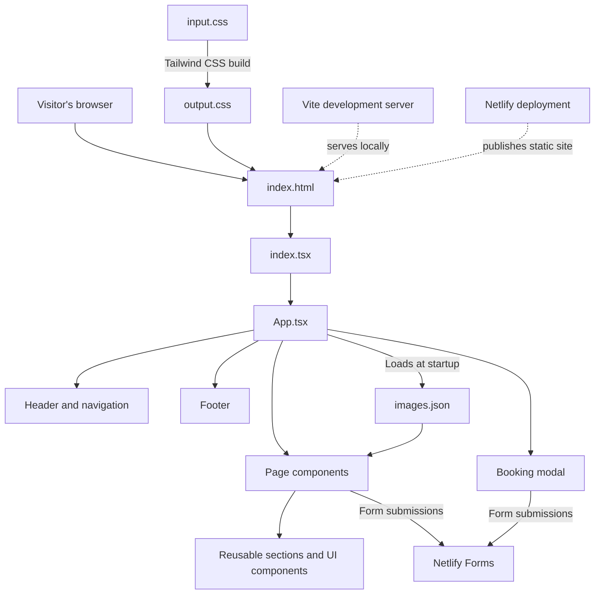

# KABIRA'S Motor Vehicle Engineering & Mechanics

A responsive website for KABIRA'S Motor Vehicle Engineering & Mechanics, an automotive repair and vehicle engineering workshop serving Karatina and Eldoret, Kenya.

The site provides information about the workshop, its services and bodywork, automotive articles, contact details, and appointment requests.

## Features

- Home, About, Services, Bodywork, Blog, and Contact pages
- Responsive navigation and page layouts
- Service information and booking modal
- Contact and appointment forms handled by Netlify Forms
- Image configuration managed in `images.json`
- Google Maps embed on the contact page

## Technology Stack

| Area | Technology |
| --- | --- |
| UI | React 19 and TypeScript |
| Development server | Vite 7 |
| Styling | Tailwind CSS 3.4, PostCSS, Autoprefixer |
| Forms and hosting | Netlify Forms and Netlify |
| Maps | Google Maps Embed |

## Architecture



The browser loads `index.html`, which mounts the React application through `index.tsx`. `App.tsx` manages page selection, shared layout, image configuration, and the booking modal. Page-specific content and reusable sections are implemented in `components/`. Tailwind compiles `input.css` into `output.css`. Contact and booking forms submit to Netlify Forms when deployed on Netlify.

## Project Structure

```text
.
├── App.tsx                 # Page selection and shared application state
├── index.tsx               # React entry point
├── index.html              # HTML shell and Netlify form declarations
├── components/             # Pages, shared layout, and UI components
├── images.json             # Page and component image configuration
├── input.css               # Tailwind CSS input
├── output.css              # Generated stylesheet loaded by the site
├── tailwind.config.js       # Tailwind theme and content paths
├── postcss.config.js        # PostCSS configuration
├── vite.config.ts           # Vite configuration
├── netlify.toml             # Netlify build and redirect settings
├── package.json             # Project scripts and dependencies
└── tsconfig.json            # TypeScript configuration
```

## Getting Started

### Requirements

- Node.js
- npm

### Install and run

```bash
git clone https://github.com/Denniskaninu/gigs-offer.git
cd gigs-offer
npm install
npm run dev
```

The development server runs at <http://localhost:3000>.

## Available Scripts

| Command | Description |
| --- | --- |
| `npm run dev` | Starts the Vite development server on port 3000 |
| `npm run build` | Compiles Tailwind CSS to `output.css` |
| `npm run build:prod` | Compiles and minifies Tailwind CSS |
| `npm run watch` | Watches source files and rebuilds Tailwind CSS |
| `npm run preview` | Starts the Vite preview server |

The build scripts generate the stylesheet; they do not bundle the application JavaScript. The Netlify configuration publishes the repository root.

## Content and Styling

- Edit page content and layout in the relevant files under `components/`.
- Update image URLs in `images.json`. This file is loaded at runtime and must be available at the site root.
- Change brand colors, fonts, and Tailwind content paths in `tailwind.config.js`.

## Deployment

The included `netlify.toml` sets the build command to `npm run build:prod`, publishes `.`, and redirects requests to `index.html` for the client-rendered site.

To deploy, import the repository into Netlify and use the build and publish settings from `netlify.toml`. After deployment, verify that Netlify detects the `contact-page` and `booking-modal` forms and test both submissions.

## License

This project is licensed under the [MIT License](LICENSE).
